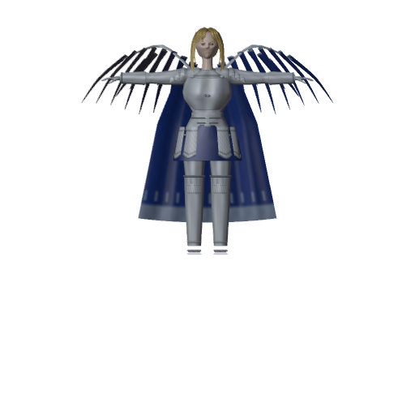
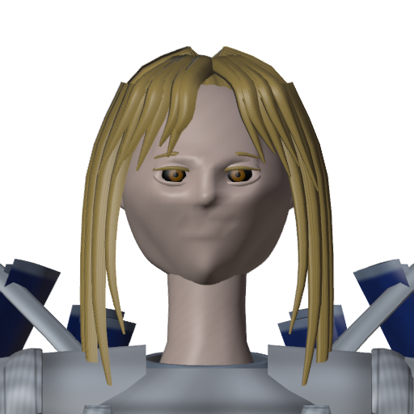
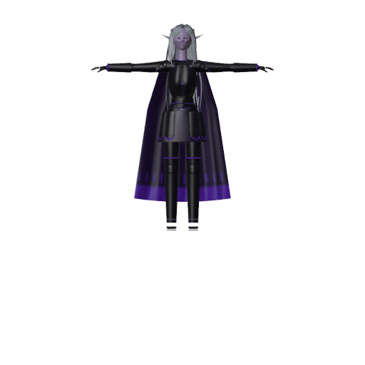
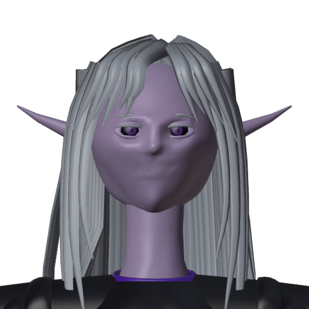
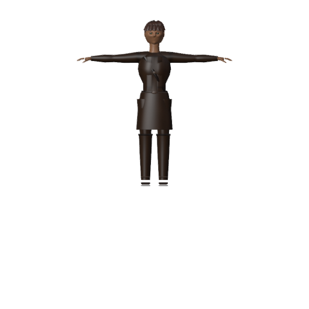
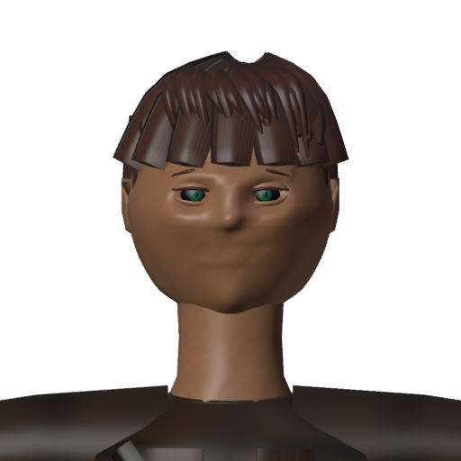

# VRM Forge Studio — E1 Quality Benchmarks

**Scope:** Aurelia, Vaelith and Marcus sample exports. This report replaces visual marketing claims with measurements. It does not rewrite sculptors or claim Unreal/VRM4U compatibility.

## Verdict

- **Source inspection:** PASS for readable GLB/VRM structure and computed statistics.
- **Blender 4.2 GLB runtime:** PARTIAL. All three GLB payloads imported and rendered headless. The requested portable Blender 4.2.23 does **not** contain `io_scene_vrm`, so `.vrm` import was not run. The GLB is the same binary payload used inside each VRM, but this is not VRM add-on acceptance.
- **Unreal/VRM4U:** UNTESTED. Unreal 5.7/5.8 executables were found; no VRM4U plugin/configured VRM4U project was found in inspected standard and project locations. See `docs/UNREAL_VRM4U_CHECKLIST.md`.
- **Quality bar:** “detailed, realistic humanoids.” These samples do not pass that bar based on the evidence below: they read as stylized/procedural low-detail characters, with 256–512px textures, simple material partitions, and deformation/self-overlap signals requiring review.

## Reproduce

From the repository worktree:

```bash
PYTHONDONTWRITEBYTECODE=1 python -I benchmarks/mesh_stats.py benchmarks/stats.json \
  F:/Projects/vrm-forge-studio/projects/*/character.vrm
F:/Projects/vrm-forge-studio/_tools/blender-4.2/blender-4.2.23-windows-x64/blender.exe \
  -b --factory-startup -P benchmarks/deform_bench.py -- <copied-character.glb> <output-dir> <name> \
  elbow_left,knee_left,shoulder_abd_left,neck_45,hip_flex_left,spine_30,elbow_right,knee_right
```

Original project files were treated read-only and copied to `_staging/tmp/e1`. Render and JSON evidence is in `benchmarks/assets/` and `benchmarks/*_deform.json`.

## Mesh statistics

Values are computed from the GLB 2 container; VRM and GLB in each sample reported identical values.

| Sample | Triangles | Vertices | Materials | Textures/images | Morph target entries | Bones | Max influences | Texture resolutions |
|---|---:|---:|---:|---:|---:|---:|---:|---|
| Aurelia | 31,044 | 17,423 | 7 | 12 | 34 | 65 | 2 | 8×512², 4×256² |
| Vaelith | 30,596 | 17,146 | 7 | 12 | 34 | 65 | 2 | 12×256² |
| Marcus | 21,824 | 12,287 | 7 | 12 | 34 | 65 | 2 | 12×256² |

The VRM extension inspection reported 55 humanoid bone mappings, 18 VRM blend-shape groups (34 mesh target entries), and 4/4/3 spring-bone groups for Aurelia/Vaelith/Marcus; each reported 2 collider groups. The armature itself contains 65 bones. “Morph target entries” counts mesh primitive target arrays; the VRM group count is reported separately above.

## Deformation benchmark

Metrics are computed after each isolated pose in Blender 4.2.23 Workbench. `max displacement` includes all meshes; `body displacement` and volume use `FaceAndBodyMesh`. Self-intersection is a cheap BVH triangle-pair count and includes baseline geometry intersections, so it is a signal, not a final collision verdict. The region-radius edge metrics were unavailable for some poses because the joint coordinate space does not overlap the selected body region; those cells are intentionally not invented.

| Sample | Pose | Max displacement m | Body max m | Body volume change % | Self-intersections posed (rest) | Result vs proposed bar |
|---|---|---:|---:|---:|---:|---|
| Aurelia | elbow 90° | 0.101 | 0.000 | 0.00 | 498 (498) | PASS* |
| Aurelia | knee 90° | 0.706 | 0.000 | 0.00 | 498 (498) | FAIL |
| Aurelia | shoulder abduction 80° | — | — | — | unmeasured | UNTESTED: axis degenerate |
| Aurelia | neck 45° | 0.289 | 0.218 | 11.93 | 501 (498) | FAIL |
| Aurelia | hip flexion 70° | 1.028 | 0.000 | 0.00 | 498 (498) | FAIL |
| Aurelia | spine bend 30° | 0.436 | 0.337 | 1.07 | 500 (498) | FAIL |
| Vaelith | elbow 90° | 0.101 | 0.000 | 0.00 | 429 (429) | PASS* |
| Vaelith | knee 90° | 0.789 | 0.000 | 0.00 | 429 (429) | FAIL |
| Vaelith | shoulder abduction 80° | — | — | — | unmeasured | UNTESTED: axis degenerate |
| Vaelith | neck 45° | 0.443 | 0.224 | 12.68 | 439 (429) | FAIL |
| Vaelith | hip flexion 70° | 1.158 | 0.000 | 0.00 | 429 (429) | FAIL |
| Vaelith | spine bend 30° | 0.489 | 0.356 | 1.15 | 432 (429) | FAIL |
| Marcus | elbow 90° | 0.101 | 0.102 | 0.00 | 654 (651) | PASS* |
| Marcus | knee 90° | 0.667 | 0.000 | 0.00 | 651 (651) | FAIL |
| Marcus | shoulder abduction 80° | — | — | — | unmeasured | UNTESTED: axis degenerate |
| Marcus | neck 45° | 0.235 | 0.214 | 10.64 | 658 (651) | FAIL |
| Marcus | hip flexion 70° | 0.969 | 0.000 | 0.00 | 651 (651) | FAIL |
| Marcus | spine bend 30° | 0.337 | 0.323 | -0.12 | 655 (651) | FAIL |

Proposed thresholds, not product requirements: no new self-intersections; no new degenerate faces; local edge stretch/compression within 0.8–1.2; body volume change within ±5%; and no missing pose. `PASS*` means only the numeric thresholds measured for that pose; the baseline self-intersection count means it is not a clean visual-quality pass.

The zero body displacement on several limb tests is a diagnostic finding: the selected `FaceAndBodyMesh` has no vertices within the chosen joint radius or is not weighted to that joint, while clothing/hair still moves. It should be treated as a deformation coverage failure, not as proof of good deformation.

## Appearance evidence

Workbench renders use the exported textures and are 512×512. They are evidence of the current assets, not a cinematic quality grade.

 

 

 

- **Aurelia:** recognizable armored stylized humanoid; armor/cloak silhouette is clear, but face, hair and hands are simple and the low-resolution textures limit fine detail. It reads closer to a procedural mannequin with themed materials than a detailed realistic humanoid.
- **Vaelith:** strongest silhouette contrast from hair/cloak and dark palette; face/hands remain simple and texture resolution is uniformly 256². The result is stylized, not realistic.
- **Marcus:** plain human presentation with fewer triangles; face and clothing forms are broad and low-detail. It is the clearest procedural/mannequin-like sample against the stated bar.

## Prioritized proposed improvements (not applied)

1. **P0 — Fix deformation coverage and coordinate-space benchmark.** Inspect `src/shared/sculptors/*`, generated rig/weights and the exporter; ensure body vertices near every required joint are actually weighted, then add a joint-local region selection. Proposed files: `src/shared/sculptors/*`, `vrmBuilder.ts`, `benchmarks/deform_bench.py`.
2. **P0 — Remove baseline geometric overlap/degeneracy.** Identify the 128 degenerate faces and baseline BVH overlaps per sample before judging posed output. Proposed files: sculptor geometry generation and `vrmBuilder.ts`.
3. **P1 — Add higher-detail appearance assets.** Increase face/hand topology, texture resolution and material detail; validate with the front/side/face render set. Proposed files: sculptor generators and asset-generation inputs.
4. **P1 — Add a real VRM 4.2 execution lane.** Install/register the supplied VRM add-on in the portable runtime or document a pinned add-on path; rerun `.vrm` import and compare against GLB. Proposed files: `benchmarks/README.md`, CI/local benchmark setup only.
5. **P2 — Run the acceptance protocol.** Set up a UE5 project with VRM4U, capture the evidence matrix for all three samples, and only then make UE/VRM4U claims. Proposed file: `docs/UNREAL_VRM4U_CHECKLIST.md` plus external evidence, not source changes.

## Limitations

No sculptor, `vrmBuilder.ts`, source generator, Unreal project, or production asset was modified. Unreal import, VRM4U, morph playback, spring physics and retargeting remain untested. The initial `.vrm` Blender run failed because `io_scene_vrm` was absent from the supplied portable Blender; that failure is recorded here rather than hidden.
